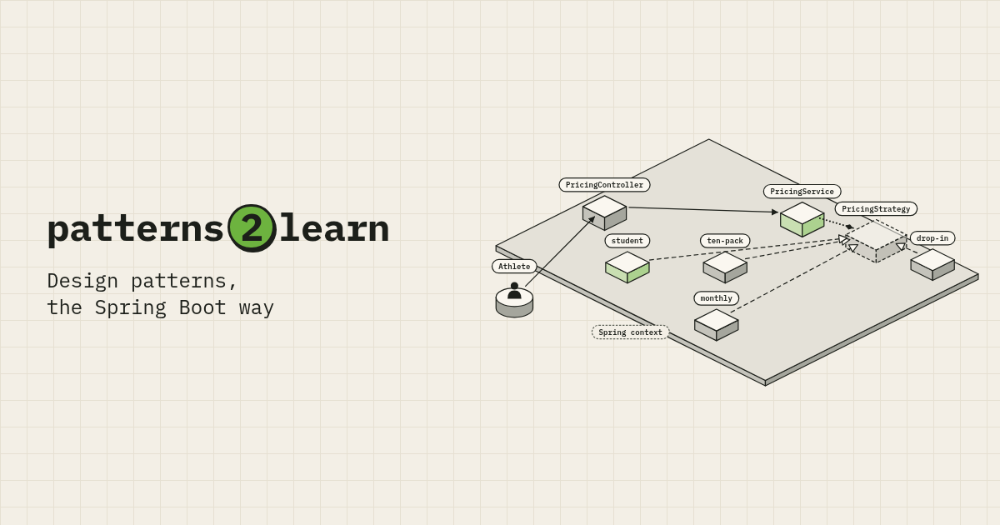
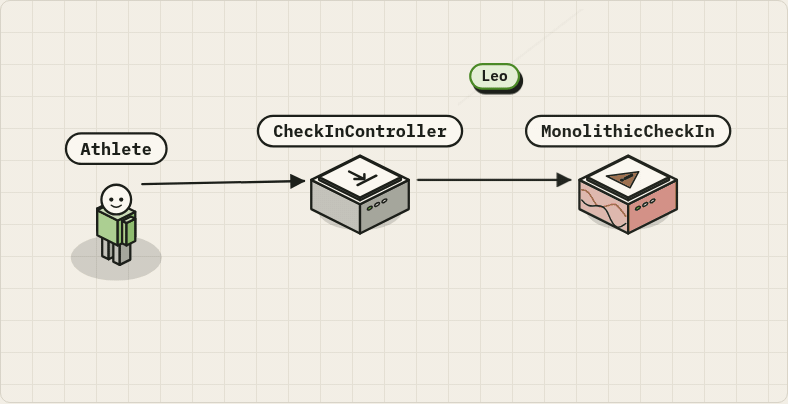
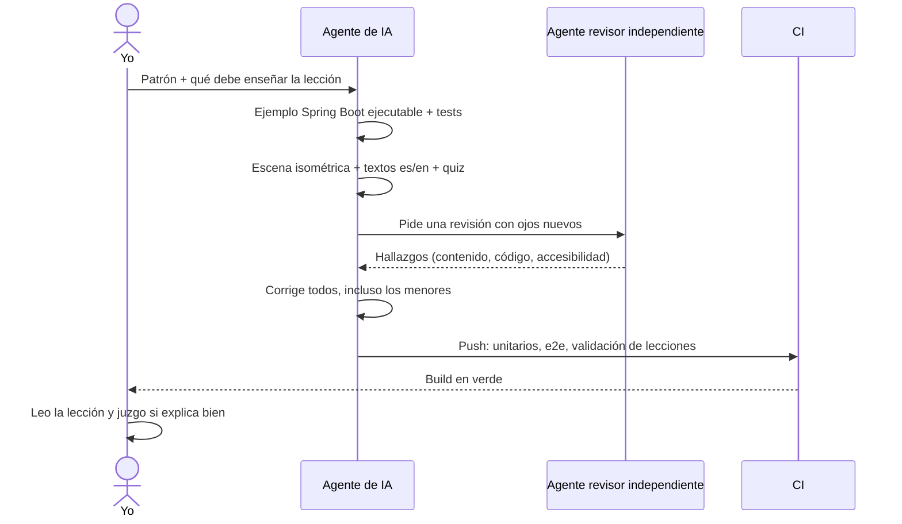
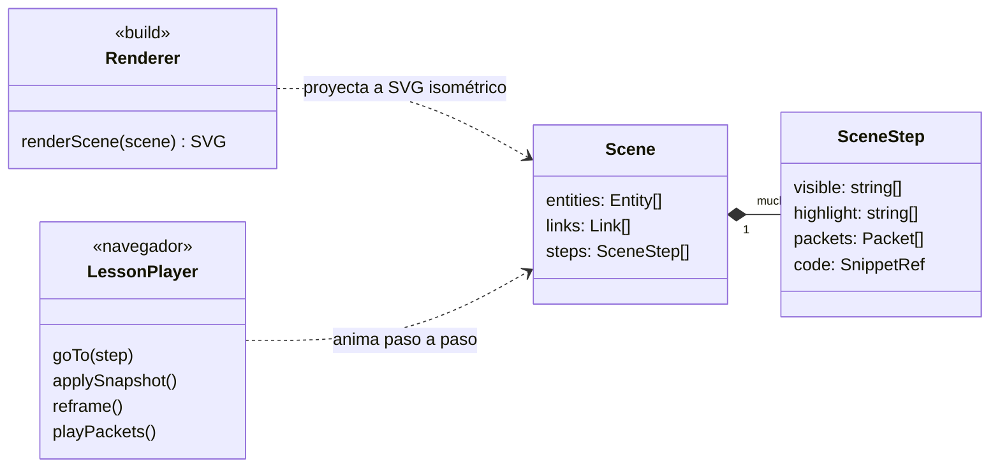

<div align="center">

<a href="https://patterns2learn.vercel.app"></a>

# patterns2learn

**Design patterns, the Spring Boot way.**<br>
Un curso interactivo de patrones de diseño que he construido para aprender a trabajar con IA.

[](https://github.com/zuldare/patterns2learn/actions/workflows/ci.yml)
[](LICENSE)


**[▶ Abrir el curso](https://patterns2learn.vercel.app/es/)** · [English](README.md) · **Español**

</div>

---

## Por qué existe

Llevo unos veinte años escribiendo software de backend, y lo que más disfruto de este oficio siempre ha sido la teoría que hay detrás: por qué un diseño aguanta, qué te aporta de verdad un patrón y cuándo es solo ceremonia. Además, me encanta explicarlo. Una pizarra, un buen ejemplo y ese momento en que a alguien le hace clic la idea.

patterns2learn es mi excusa para hacer dos cosas a la vez:

1. **Aprender a trabajar con IA de verdad.** No hablo de pedir fragmentos de código. Hablo de llevar un proyecto entero con un agente de IA como compañero de equipo: spec, decisiones de diseño, código, revisiones, CI y despliegues.
2. **Construir algo que me apasiona.** Quería un curso sobre los 23 patrones clásicos del libro de la *Gang of Four*, explicado como a mí me gusta explicarlo: paso a paso, con un dibujo que se mueve y con código real que puedes ejecutar.

<div align="center">
  
  <br><sub><em>Chain of Responsibility: la petición recorre la cadena y una regla la corta.</em></sub>
</div>

## Qué encontrarás

- 🧩 **Los 23 patrones GoF**, cada uno en una lección corta (unos 10 minutos) en **español e inglés**.
- 🗺️ **Un diagrama isométrico animado** que se construye paso a paso: el problema, por qué huele mal, el patrón y, al final, *"así lo hace ya Spring"*.
- ☕ **Código Spring Boot real** junto al diagrama, con las líneas importantes de cada paso resaltadas. Cada fragmento sale de una aplicación ejecutable y con tests en [`examples/`](examples).
- ✅ **Un cuestionario y una chuleta imprimible** al final de cada lección.
- 🎨 **Tres temas** (papel, blueprint y oscuro). Se respetan la navegación con teclado, las descripciones para lectores de pantalla y la preferencia de movimiento reducido.

| Categoría | Patrones |
|---|---|
| **Creacionales** | [Abstract Factory](https://patterns2learn.vercel.app/es/patterns/abstract-factory/) · [Builder](https://patterns2learn.vercel.app/es/patterns/builder/) · [Factory Method](https://patterns2learn.vercel.app/es/patterns/factory-method/) · [Prototype](https://patterns2learn.vercel.app/es/patterns/prototype/) · [Singleton](https://patterns2learn.vercel.app/es/patterns/singleton/) |
| **Estructurales** | [Adapter](https://patterns2learn.vercel.app/es/patterns/adapter/) · [Bridge](https://patterns2learn.vercel.app/es/patterns/bridge/) · [Composite](https://patterns2learn.vercel.app/es/patterns/composite/) · [Decorator](https://patterns2learn.vercel.app/es/patterns/decorator/) · [Facade](https://patterns2learn.vercel.app/es/patterns/facade/) · [Flyweight](https://patterns2learn.vercel.app/es/patterns/flyweight/) · [Proxy](https://patterns2learn.vercel.app/es/patterns/proxy/) |
| **De comportamiento** | [Chain of Responsibility](https://patterns2learn.vercel.app/es/patterns/chain-of-responsibility/) · [Command](https://patterns2learn.vercel.app/es/patterns/command/) · [Interpreter](https://patterns2learn.vercel.app/es/patterns/interpreter/) · [Iterator](https://patterns2learn.vercel.app/es/patterns/iterator/) · [Mediator](https://patterns2learn.vercel.app/es/patterns/mediator/) · [Memento](https://patterns2learn.vercel.app/es/patterns/memento/) · [Observer](https://patterns2learn.vercel.app/es/patterns/observer/) · [State](https://patterns2learn.vercel.app/es/patterns/state/) · [Strategy](https://patterns2learn.vercel.app/es/patterns/strategy/) · [Template Method](https://patterns2learn.vercel.app/es/patterns/template-method/) · [Visitor](https://patterns2learn.vercel.app/es/patterns/visitor/) |

## Cómo lo he construido con IA

He construido todo el proyecto con [Claude Code](https://claude.com/claude-code) como compañero. Así es como trabajo con él y esto es lo que he aprendido por el camino.

**Le doy contexto antes de pedirle código.** El proyecto vive en una [spec](docs/spec.md) y en [registros de decisiones de arquitectura](docs/adr). Además, guardo las normas del proyecto en la memoria del agente: git trunk-based, todos los diagramas como UML en Mermaid y un bucle fijo para cada patrón. Un agente bien informado comete muchos menos errores creativos.

**Dejo que me interrogue antes de construir.** Para cualquier cosa que no sea trivial empiezo con la skill [*grill-me*](https://github.com/mattpocock/skills/tree/main/skills/productivity/grill-me). El agente me entrevista por rondas, recomienda una respuesta para cada pregunta y no empieza hasta que cada rama del árbol de decisiones está cerrada. Este mismo README lo he trabajado así. **Mi consejo:** si tuviera que recomendar un solo hábito a quien trabaje con agentes de IA, sería este. La mayoría de los malos resultados vienen de cosas que nadie decidió en voz alta.

**Cada patrón pasa por el mismo bucle:**



**Quién hace qué.** La IA escribe la mayor parte del código. Las decisiones de diseño, el guion pedagógico de cada lección y la última palabra sobre "¿esto explica de verdad la idea?" son míos. Los tests, un validador de lecciones y el CI son la red de seguridad que me permite fiarme de la velocidad.

**Lo que más me ha sorprendido.** Después de dos décadas en backend, lo que me ha fascinado es el front: cómo encajan las imágenes, el CSS, las capas, los SVG y las transiciones. El motor de animación no usa ninguna librería de animación. Cada lección es solo datos (piezas sobre una rejilla y una lista de "fotos"), y un pequeño reproductor convierte la diferencia entre dos fotos en fundidos, movimientos de cámara y mensajes que viajan por las flechas:



He aprendido más sobre el navegador en este proyecto que en años leyendo sobre él, y de eso se trataba.

## Para desarrolladores

<details>
<summary><strong>Estructura del repositorio, comandos y cómo citan código las lecciones</strong></summary>

### Estructura

- `examples/`: proyecto Maven multimódulo (Java 25, Spring Boot 4) con una aplicación con tests por patrón en `examples/<categoría>/<patrón>`.
- `web/`: sitio estático en Astro (TypeScript estricto).
  - `src/content/lessons/<slug>/`: `scene.ts` (entidades, enlaces y pasos del diagrama) más `es.md` y `en.md` (textos de cada paso, resumen y cuestionario).
  - `src/engine/`: proyección isométrica, renderizador SVG y reproductor de lecciones.
  - `src/lib/`: carga y validación de lecciones, extracción de fragmentos y resaltado.
- `docs/`: [spec del producto](docs/spec.md), [ADRs](docs/adr) y planes.

### Primeros pasos

Las herramientas (Java 25, Node 26, pnpm 12) están fijadas con [mise](https://mise.jdx.dev):

```bash
mise install

# examples
cd examples
./mvnw verify                                   # compila y prueba todos los módulos
./mvnw -pl behavioral/strategy spring-boot:run  # arranca la demo de Strategy en :8080
curl 'localhost:8080/api/pricing/quote?plan=ten-pack&sessions=12'

# web
cd web
pnpm install
pnpm dev          # http://localhost:4321
pnpm test         # tests unitarios (vitest)
pnpm check        # astro check (tipos)
pnpm build        # build estático en dist/ (valida cada lección)
pnpm test:e2e     # Playwright (en local usa /usr/bin/chromium)
```

### Fragmentos de código en las lecciones

Las lecciones nunca copian código. Un paso apunta a una región de un fichero Java dentro de `examples/`, y el build la extrae:

```java
// @step:ten-pack-strategy
@Component("ten-pack")
public class TenPackPricing implements PricingStrategy { ... }
// @end
```

```ts
code: { file: 'behavioral/strategy/src/main/java/.../TenPackPricing.java', region: 'ten-pack-strategy', highlight: [1] }
```

`file` es relativo a `examples/`, y `highlight` lista líneas (empezando en 1) dentro de la región. El build falla si falta una región, si hay un marcador duplicado, si una línea está fuera de rango o si los textos es/en no coinciden con los pasos de la escena.

### Despliegue (Vercel)

El sitio se despliega desde `web/` (Root Directory `web`, ver `web/vercel.json`). Las lecciones leen su código de `../examples` durante el build, así que hay que activar **"Include files outside of the Root Directory in the Build Step"**. Node 26 se selecciona con `engines.node`.

</details>

## Referencias

**La fuente.** Erich Gamma, Richard Helm, Ralph Johnson y John Vlissides, [*Design Patterns: Elements of Reusable Object-Oriented Software*](https://www.oreilly.com/library/view/design-patterns-elements/0201633612/) (Addison-Wesley, 1994). Cada lección se contrasta con él.

**Lecturas recomendadas.**
- Eric Freeman y Elisabeth Robson, [*Head First Design Patterns*](https://www.oreilly.com/library/view/head-first-design/9781492077992/) (2.ª ed., O'Reilly, 2020)
- Martin Fowler, [*Refactoring*](https://martinfowler.com/books/refactoring.html) (2.ª ed., Addison-Wesley, 2018)
- Martin Fowler, [*Patterns of Enterprise Application Architecture*](https://martinfowler.com/books/eaa.html) (Addison-Wesley, 2002)
- [Documentación de referencia de Spring Framework](https://docs.spring.io/spring-framework/reference/), de donde sale el paso *"así lo hace Spring"* de cada lección

**Inspiración.**
- [refactoring.guru](https://refactoring.guru/design-patterns): por lo claro que explica cada patrón
- [designed-to-scale](https://designed-to-scale.vercel.app/): por el formato de lección isométrica paso a paso

## Sobre mí

Soy Jaime Hernández, ingeniero de backend al que le gusta demasiado la teoría del software y que disfruta todavía más explicándola.

[](https://www.linkedin.com/in/jaimehernandezortiz)
[](https://github.com/zuldare)
[](https://paypal.me/binauraljames)

Si el curso te ha servido, una ⭐ en el repo o un café ayudan a que siga adelante.

## Licencia

[MIT](LICENSE) © 2026 Jaime Hernández
