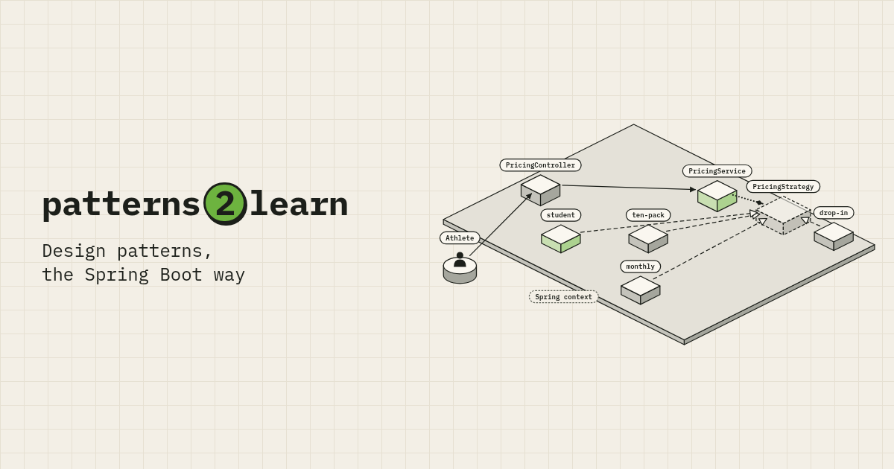
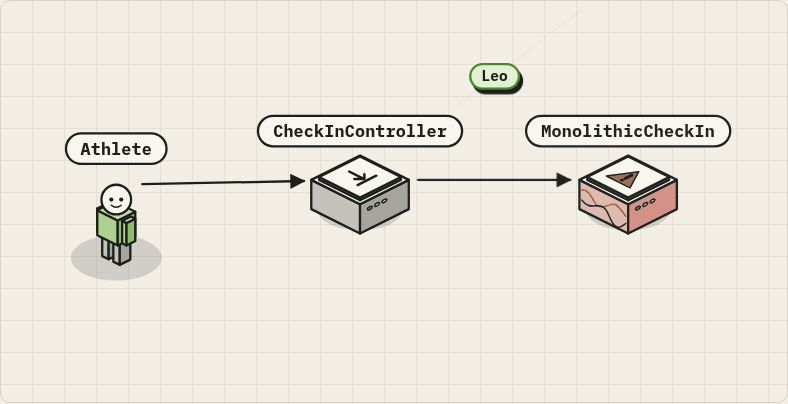
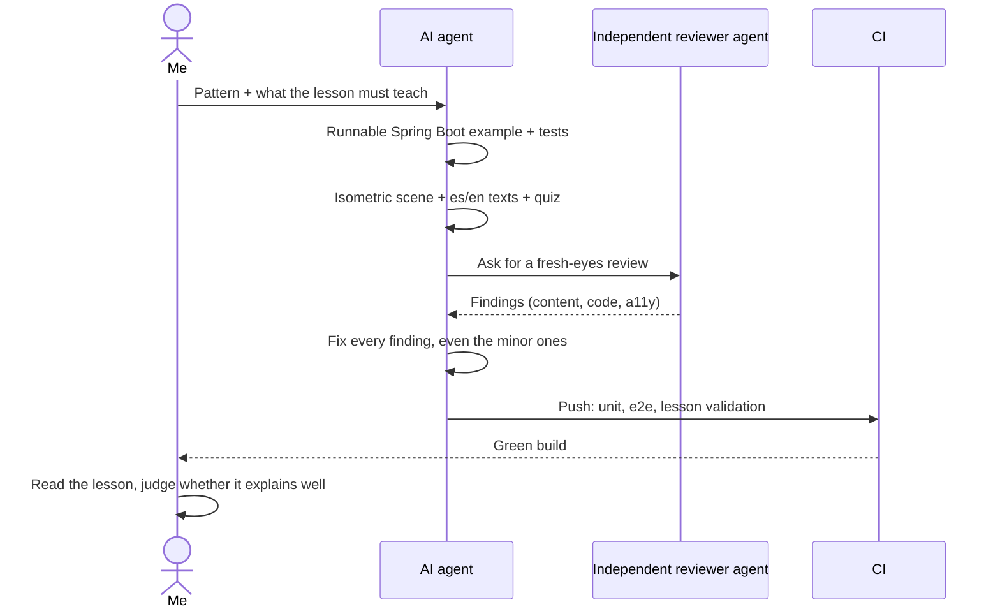
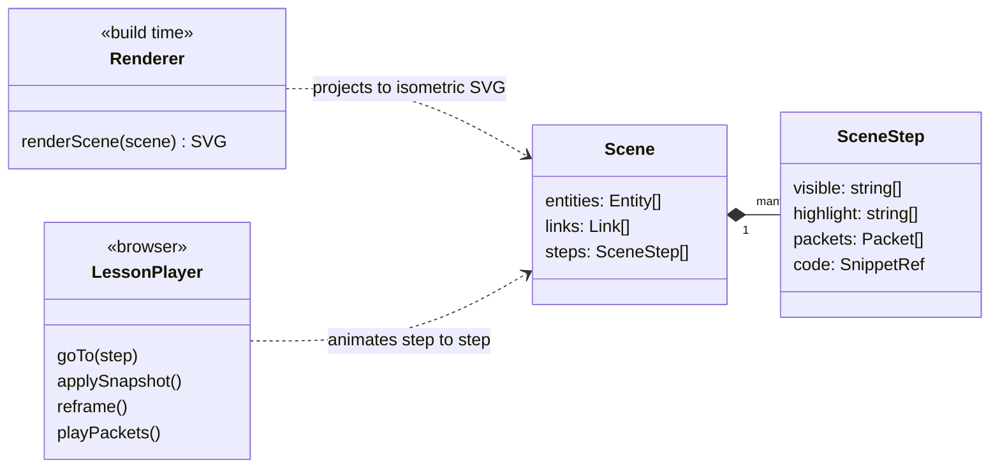

<div align="center">

<a href="https://patterns2learn.vercel.app"></a>

# patterns2learn

**Design patterns, the Spring Boot way.**<br>
An interactive design-patterns course that I built to learn how to work with AI.

[](https://github.com/zuldare/patterns2learn/actions/workflows/ci.yml)
[](LICENSE)


**[▶ Open the course](https://patterns2learn.vercel.app)** · **English** · [Español](README.es.md)

</div>

---

## Why this exists

I've spent about twenty years writing backend software, and the part of the job I enjoy most has always been the theory behind it: why a design holds up, what a pattern is really buying you, and when it's just ceremony. I also love explaining these things. A whiteboard, a good example, and the moment the idea clicks for someone.

patterns2learn is my excuse to do two things at once:

1. **Learn to work with AI for real.** I don't mean asking for snippets. I mean running a whole project with an AI agent as a teammate: spec, design decisions, code, reviews, CI and deploys.
2. **Build something I care about.** I wanted a course on the 23 classic patterns from the *Gang of Four* book, explained the way I like to explain them: step by step, with a picture that moves, and with real code you can run.

<div align="center">
  
  <br><sub><em>Chain of Responsibility: the request walks the chain, and one rule cuts it short.</em></sub>
</div>

## What you get

- 🧩 **All 23 GoF patterns**, each one a short lesson (about 10 minutes) in **Spanish and English**.
- 🗺️ **An animated isometric diagram** that builds up one step at a time: the problem, why it smells, the pattern, and finally *"how Spring already does it"*.
- ☕ **Real Spring Boot code** next to the diagram, with the lines that matter in each step highlighted. Every snippet comes from a runnable, tested app in [`examples/`](examples).
- ✅ **A quiz and a printable cheatsheet** at the end of every lesson.
- 🎨 **Three themes** (paper, blueprint and dark). Keyboard navigation, screen-reader descriptions and reduced motion are respected.

| Category | Patterns |
|---|---|
| **Creational** | [Abstract Factory](https://patterns2learn.vercel.app/en/patterns/abstract-factory/) · [Builder](https://patterns2learn.vercel.app/en/patterns/builder/) · [Factory Method](https://patterns2learn.vercel.app/en/patterns/factory-method/) · [Prototype](https://patterns2learn.vercel.app/en/patterns/prototype/) · [Singleton](https://patterns2learn.vercel.app/en/patterns/singleton/) |
| **Structural** | [Adapter](https://patterns2learn.vercel.app/en/patterns/adapter/) · [Bridge](https://patterns2learn.vercel.app/en/patterns/bridge/) · [Composite](https://patterns2learn.vercel.app/en/patterns/composite/) · [Decorator](https://patterns2learn.vercel.app/en/patterns/decorator/) · [Facade](https://patterns2learn.vercel.app/en/patterns/facade/) · [Flyweight](https://patterns2learn.vercel.app/en/patterns/flyweight/) · [Proxy](https://patterns2learn.vercel.app/en/patterns/proxy/) |
| **Behavioral** | [Chain of Responsibility](https://patterns2learn.vercel.app/en/patterns/chain-of-responsibility/) · [Command](https://patterns2learn.vercel.app/en/patterns/command/) · [Interpreter](https://patterns2learn.vercel.app/en/patterns/interpreter/) · [Iterator](https://patterns2learn.vercel.app/en/patterns/iterator/) · [Mediator](https://patterns2learn.vercel.app/en/patterns/mediator/) · [Memento](https://patterns2learn.vercel.app/en/patterns/memento/) · [Observer](https://patterns2learn.vercel.app/en/patterns/observer/) · [State](https://patterns2learn.vercel.app/en/patterns/state/) · [Strategy](https://patterns2learn.vercel.app/en/patterns/strategy/) · [Template Method](https://patterns2learn.vercel.app/en/patterns/template-method/) · [Visitor](https://patterns2learn.vercel.app/en/patterns/visitor/) |

## How I built it with AI

I built the whole project with [Claude Code](https://claude.com/claude-code) as my pair. Here is how I work with it and what I've learned along the way.

**I give it context before I ask for code.** The project lives in a [spec](docs/spec.md) and in [architecture decision records](docs/adr). I also keep the project's ground rules in the agent's memory: trunk-based git, every diagram as UML in Mermaid, and a fixed loop for each pattern. A well-briefed agent makes far fewer creative mistakes.

**I let it grill me before it builds.** For anything non-trivial, I start with the [*grill-me*](https://github.com/mattpocock/skills/tree/main/skills/productivity/grill-me) skill. The agent interviews me in rounds, recommends an answer to each question, and only starts once every branch of the decision tree is settled. I worked on this very README that way. **My tip:** if there's one habit I'd recommend to anyone working with AI agents, it's this one. Most bad results come from things nobody decided out loud.

**Every pattern goes through the same loop:**



**Who does what.** The AI writes most of the code. The design decisions, the teaching script of each lesson and the final call on "does this actually explain the idea?" are mine. Tests, a lesson validator and CI are the safety net that lets me trust the speed.

**What surprised me most.** After two decades in backend work, the part that has amazed me is the front end: how images, CSS, layers, SVG and transitions fit together. The animation engine has no animation library at all. Each lesson is just data (pieces on a grid plus a list of "snapshots"), and a small player turns the difference between two snapshots into fades, camera moves and messages travelling along the arrows:



I learned more about the browser in this project than in years of reading about it, and that was exactly the point.

## For developers

<details>
<summary><strong>Repository layout, commands and how lessons quote code</strong></summary>

### Layout

- `examples/`: Maven multi-module project (Java 25, Spring Boot 4) with one tested app per pattern at `examples/<category>/<pattern>`.
- `web/`: Astro static site (strict TypeScript).
  - `src/content/lessons/<slug>/`: `scene.ts` (entities, links and steps of the diagram) plus `es.md` and `en.md` (step texts, recap and quiz).
  - `src/engine/`: isometric projection, SVG renderer and lesson player.
  - `src/lib/`: lesson loading, validation, snippet extraction and highlighting.
- `docs/`: [product spec](docs/spec.md), [ADRs](docs/adr) and plans.

### Getting started

The toolchain (Java 25, Node 26, pnpm 12) is pinned with [mise](https://mise.jdx.dev):

```bash
mise install

# examples
cd examples
./mvnw verify                                   # build and test every module
./mvnw -pl behavioral/strategy spring-boot:run  # run the Strategy demo on :8080
curl 'localhost:8080/api/pricing/quote?plan=ten-pack&sessions=12'

# web
cd web
pnpm install
pnpm dev          # http://localhost:4321
pnpm test         # unit tests (vitest)
pnpm check        # astro check (types)
pnpm build        # static build into dist/ (validates every lesson)
pnpm test:e2e     # Playwright (locally uses /usr/bin/chromium)
```

### Code snippets in lessons

Lessons never copy code. A step points at a region of a Java file under `examples/`, and the build extracts it:

```java
// @step:ten-pack-strategy
@Component("ten-pack")
public class TenPackPricing implements PricingStrategy { ... }
// @end
```

```ts
code: { file: 'behavioral/strategy/src/main/java/.../TenPackPricing.java', region: 'ten-pack-strategy', highlight: [1] }
```

`file` is relative to `examples/`, and `highlight` lists 1-based lines inside the region. The build fails on a missing region, a duplicate marker, an out-of-range line, or es/en texts that don't match the scene's steps.

### Deployment (Vercel)

The site deploys from `web/` (Root Directory `web`, see `web/vercel.json`). Lessons read their code from `../examples` at build time, so **"Include files outside of the Root Directory in the Build Step"** must be enabled. Node 26 is selected through `engines.node`.

</details>

## References

**The source.** Erich Gamma, Richard Helm, Ralph Johnson and John Vlissides, [*Design Patterns: Elements of Reusable Object-Oriented Software*](https://www.oreilly.com/library/view/design-patterns-elements/0201633612/) (Addison-Wesley, 1994). Every lesson is checked against it.

**Recommended reading.**
- Eric Freeman and Elisabeth Robson, [*Head First Design Patterns*](https://www.oreilly.com/library/view/head-first-design/9781492077992/) (2nd ed., O'Reilly, 2020)
- Martin Fowler, [*Refactoring*](https://martinfowler.com/books/refactoring.html) (2nd ed., Addison-Wesley, 2018)
- Martin Fowler, [*Patterns of Enterprise Application Architecture*](https://martinfowler.com/books/eaa.html) (Addison-Wesley, 2002)
- [Spring Framework reference documentation](https://docs.spring.io/spring-framework/reference/), where the *"how Spring does it"* step of every lesson comes from

**Inspiration.**
- [refactoring.guru](https://refactoring.guru/design-patterns): for how clearly it explains each pattern
- [designed-to-scale](https://designed-to-scale.vercel.app/): for the step-by-step isometric lesson format

## About me

I'm Jaime Hernández, a backend engineer who likes software theory a little too much and enjoys explaining it even more.

[](https://www.linkedin.com/in/jaimehernandezortiz)
[](https://github.com/zuldare)
[](https://paypal.me/binauraljames)

If the course helped you, a ⭐ on the repo or a coffee keeps it going.

## License

[MIT](LICENSE) © 2026 Jaime Hernández
