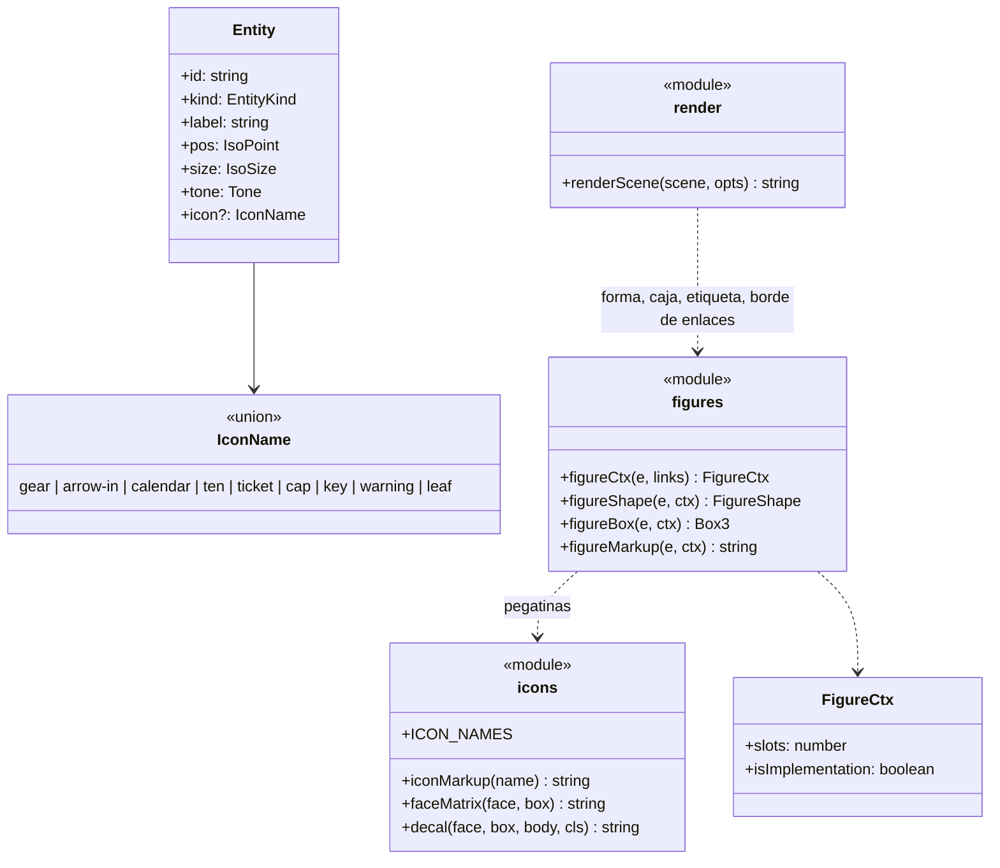
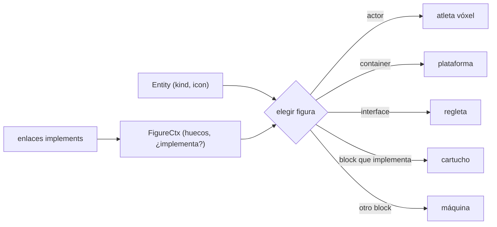

# ADR 0001: Figuras «Taller» para el motor isométrico

- **Estado:** aceptada (2026-11-19)
- **Diseño:** [docs/superpowers/specs/2026-11-19-figures-taller-design.md](../superpowers/specs/2026-11-19-figures-taller-design.md)
- **Referencia visual:** `/lab/figuras/`, una página sin enlazar y con `noindex`

## Contexto

En la primera lección, cada clase se dibujaba con el mismo prisma gris. Solo cambiaban el color y la etiqueta, y el resultado se percibía «demasiado serio». Antes de reutilizar el motor en las otras 7 lecciones se compararon tres opciones en un laboratorio con los mismos datos de escena:

- el estilo actual;
- **A · Taller**: objetos técnicos con detalle;
- **B · El box**: material de CrossFit.

Se eligió la opción A.

## Decisión

Cada entidad se dibuja como una figura «Taller».

- **La forma no se declara: se deriva** del `kind` y de los enlaces `implements` de la escena:
  - un bloque que implementa una interfaz es un **cartucho**;
  - la **regleta** de una interfaz tiene un hueco por cada implementación.
- **Las lecciones solo eligen un `icon`** de un catálogo cerrado. El validador rechaza iconos desconocidos y los iconos en actores y contenedores.
- **Los iconos son «pegatinas».** Se dibujan en el cuadrado unidad y se proyectan sobre una cara con una matriz afín, que calcula `faceMatrix`.
- **Todo color es un token.** Cada superficie sombreada lleva `iso-face`, así que el resaltado y los discontinuos de `engine.css` siguen funcionando sin cambios.

`renderScene` mantiene su firma y su contrato de salida: clases, `data-*`, capas y accesibilidad. Lo que cambia es la geometría de cada figura:

- la etiqueta se coloca sobre el punto más alto de la figura;
- los enlaces se anclan al centro de la tapa de la caja de la figura y se recortan en su borde;
- el `viewBox` incluye las cajas de las figuras.

## Alternativas

| Alternativa | Por qué no |
|---|---|
| Nuevos `EntityKind` (`cartridge`, `socket`…) | Duplican lo que ya dicen los enlaces y multiplican los casos del validador y del renderer. |
| Pieles intercambiables (A/B en tiempo de ejecución) | YAGNI: solo se eligió A, y habría que duplicar los tests de cada figura. |
| B · El box (material de gimnasio) | Más divertida, pero obliga a inventar una metáfora por patrón y algunas quedarían forzadas. |

## Consecuencias

- **Para quien escribe lecciones:** las escenas ganan expresividad sin datos nuevos, más allá del `icon` opcional. No se puede desincronizar el número de huecos con las implementaciones.
- **Iconos nuevos:** cada uno se añade al catálogo (`engine/icons.ts`) con su test, y aparece automáticamente en `/lab/figuras/`.
- **Móvil:** el diagrama ya se reduce al 45 %, así que los detalles pequeños (LEDs, iconos) apenas se aprecian. Las etiquetas siguen siendo lo principal.
- **Actor:** el tono de un `actor` ya no cambia su color, porque la camiseta del atleta es siempre de acento.
