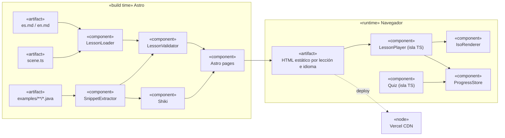
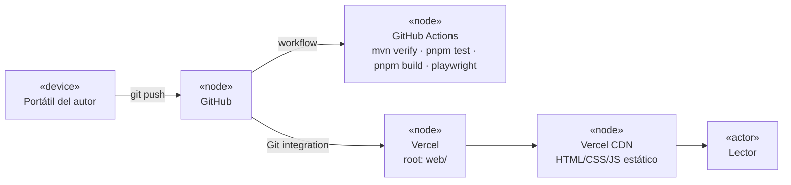
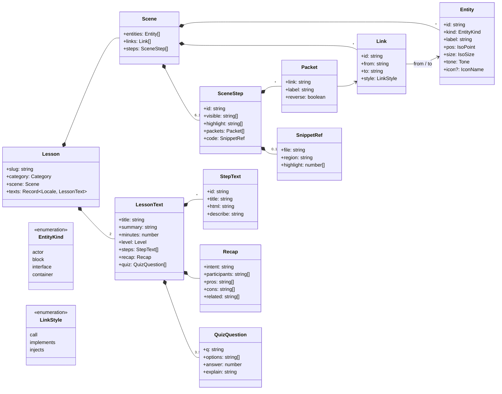
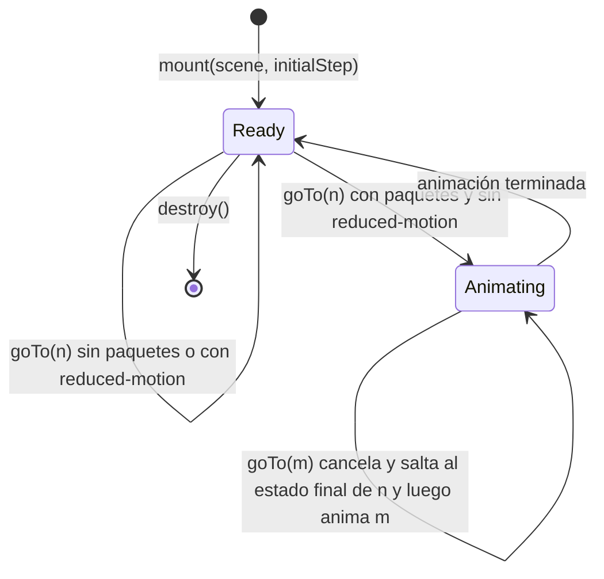
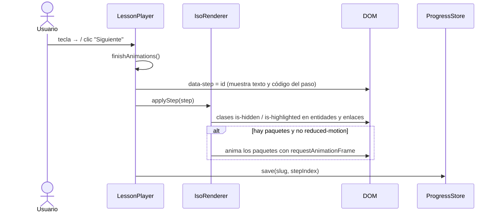
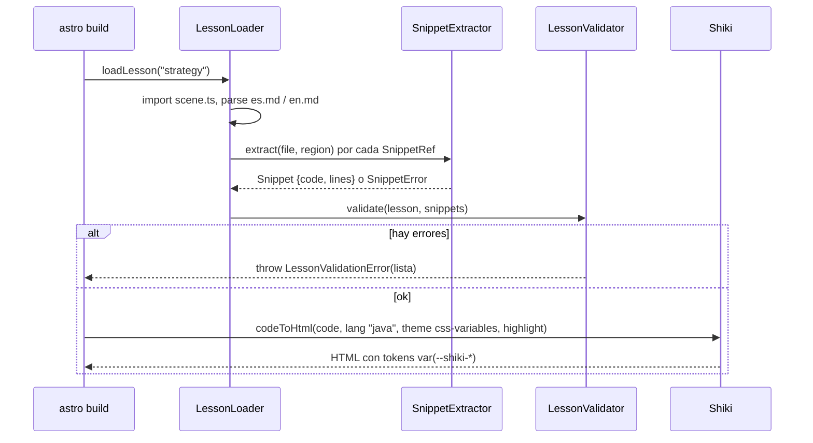
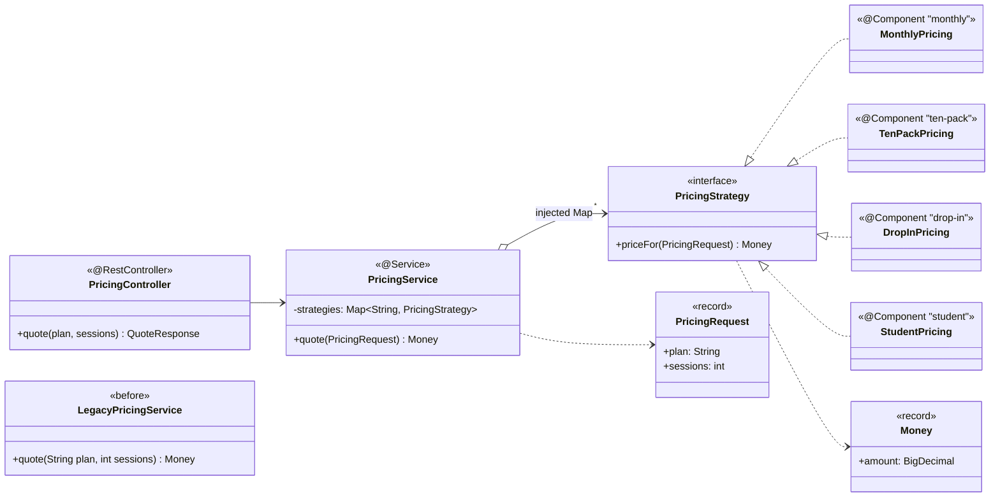
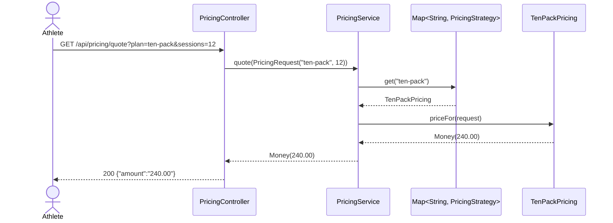

# patterns2learn — Especificación

> **Design patterns, the Spring Boot way.**
> Curso visual e interactivo de patrones de diseño, centrado en cómo se implementan y dónde aparecen en Spring Boot.

- **Estado:** aprobado, 2026-11-18
- **Alcance de este documento:** el producto completo (visión) y la versión 1 (lanzamiento)
- **Convención de diagramas:** todos los diagramas de arquitectura, clases, secuencia, estados y decisiones se hacen en **UML con Mermaid** dentro del Markdown, porque GitHub los renderiza de forma nativa.

---

## 1. Visión

Una web gratuita donde cada patrón de diseño es una **lección por pasos con un diagrama isométrico animado**. Al lado, el **código Java real** de una aplicación Spring Boot resalta en cada paso las líneas que corresponden. La experiencia está inspirada en la mecánica de [designed-to-scale](https://designed-to-scale.vercel.app/) (lección por pasos, diagramas isométricos), pero con identidad visual propia.

### 1.1 Público

Desarrolladores Java que **ya usan Spring Boot** (beans, `@Service`, inyección) pero no dominan los patrones de diseño, más quien prepara entrevistas técnicas. No se explica Java ni Spring desde cero.

### 1.2 Fuentes de referencia

| Fuente | Uso |
|---|---|
| *Design Patterns* (GoF, 1994) | Rigor: intención, participantes, consecuencias |
| refactoring.guru | Pedagogía: problema → solución, analogías |
| designed-to-scale | Mecánica de la experiencia: pasos, isometría, layout |

**Regla de originalidad:** ningún texto, diagrama ni estilo se copia de estas fuentes. Todo el contenido se escribe desde cero.

### 1.3 Negocio y licencia

- Todo es gratis. Se monetiza con **donaciones**: un botón de Buy Me a Coffee (o PayPal.me) en la cabecera y una tarjeta al final de cada lección.
- **Licencia MIT para todo el repositorio**, web, contenido y ejemplos.
- No hay cuentas, pagos ni backend.

---

## 2. Alcance

### 2.1 Catálogo completo (visión)

- **GoF (23):**
  - Creacionales (5)
  - Estructurales (7)
  - Comportamiento (11), incluido Interpreter
- **Patrones de Spring:** IoC/DI, AOP, Front Controller (`DispatcherServlet`), Repository, Template (`JdbcTemplate`), Event Publisher…
- Los patrones con poca presencia en Spring (Interpreter, Flyweight, Memento) tienen lecciones más cortas.

### 2.2 Versión 1 (lanzamiento)

**Patrones:** Singleton, Factory Method, Proxy, Template Method, Strategy, Observer, Decorator y Chain of Responsibility.

**Secciones:**
- **Learn:** las lecciones
- **Quiz:** de 3 a 5 preguntas al final de cada lección
- **Cheatsheet:** una ficha imprimible por patrón

**Primer entregable:** una lección vertical completa de **Strategy**. Es la que valida el motor, los temas, los idiomas, el código sincronizado, el quiz, el cheatsheet, el módulo Maven y el despliegue. El plan de este entregable está en [`docs/superpowers/plans/2026-11-18-strategy-vertical-slice.md`](superpowers/plans/2026-11-18-strategy-vertical-slice.md).

### 2.3 Fuera de la versión 1

Sección Practice propia, Pattern finder, Playground de diagramas, cuentas de usuario, ejecución de código en el navegador y más idiomas aparte de español e inglés.

---

## 3. Modelo pedagógico: anatomía de una lección

Cada lección sigue un arco fijo de **6 a 10 pasos**:

1. **Problema:** una situación real en la app Spring Boot del box de CrossFit.
2. **Solución:** el patrón implementado "a lo Spring".
3. **Spring ya lo hace por ti:** dónde usa Spring este patrón internamente.
4. **Resumen:** tarjeta con la intención del GoF, los participantes, pros y contras y los patrones relacionados.
5. Quiz y enlace al módulo ejecutable del repositorio.

Cada paso tiene tres vistas sincronizadas:

| Vista | Contenido |
|---|---|
| Lienzo isométrico | Estado del diagrama en ese paso (bloques visibles, resaltados, paquetes en movimiento) |
| Panel de texto | Explicación, con callouts `problem`, `key-idea`, `spring` y `warning` |
| Panel de código | Fragmento Java extraído del ejemplo real, con líneas resaltadas |

---

## 4. Dominio: un box de CrossFit

Todos los ejemplos comparten un dominio para que los patrones se conecten entre sí. El código está en inglés: `Athlete`, `Wod`, `Booking`, `Membership`, `Coach`, `Box`.

| Patrón | Caso en el box | Dónde lo usa Spring |
|---|---|---|
| Singleton | `WodCatalog`, un único catálogo de entrenamientos | scope singleton de los beans |
| Factory Method | crear tipos de WOD (AMRAP, EMOM, For Time) | `FactoryBean`, `BeanFactory` |
| Proxy | `@Transactional` al reservar plaza en una clase | proxies de AOP |
| Template Method | importar resultados de atletas (CSV o API) | `JdbcTemplate`, `RestClient` |
| Strategy | calcular la cuota (mensual, bono de 10, drop-in) | `Map<String, Strategy>` inyectado, `DelegatingPasswordEncoder` |
| Observer | nuevo PR (récord personal) → notificación, ranking, badge | `ApplicationEvent`, `@EventListener` |
| Decorator | extras en un plan (fisio, nutrición) | `BeanPostProcessor`, wrappers |
| Chain of Responsibility | acceso al box (membresía al día, aforo, waiver) | filtros de Spring Security |

**Tono:** cercano, tuteando, con guiños moderados de CrossFit en los ejemplos. Nada de chistes forzados en cada paso.

---

## 5. Experiencia de usuario

### 5.1 Layout

**Escritorio (≥ 1200 px), tres columnas:**
- **Cabecera:** marca, selector de idioma, selector de tema y botón de donar.
- **Izquierda:** árbol del curso por categoría GoF, con el progreso de cada módulo.
- **Centro:** lienzo isométrico, barra de pasos y panel de código plegable.
- **Derecha:** texto del paso y botones Anterior / Siguiente.

**Tablet (960–1199 px):** dos columnas. El árbol pasa a un cajón lateral.

**Móvil (< 960 px):** una columna en este orden: diagrama, barra de pasos, texto y código (en una pestaña plegable). Sin scroll horizontal y con márgenes de 16 px.

**Portada:**
- Presentación del curso.
- Bloque **"Empieza aquí"**, con el orden recomendado para los 8 patrones iniciales: Singleton → Proxy → Template Method → Strategy → Observer → Decorator → Chain of Responsibility → Factory Method. Es decir, primero lo que Spring ya usa y después lo que implementas tú.
- Árbol completo.

### 5.2 Temas

Hay tres temas, definidos con tokens CSS en `:root[data-theme]`: Papel (`paper`), Blueprint (`blueprint`) y Oscuro (`dark`). El botón de la cabecera los recorre en ese orden y muestra el nombre del siguiente. La elección se guarda en `localStorage`; si no hay elección, se usa `prefers-color-scheme` (oscuro → Oscuro, claro → Papel).

| Token | Papel (claro) | Blueprint (azul) | Oscuro |
|---|---|---|---|
| `--bg` | `#f3efe6` | `#0e2f57` | `#2b2b2b` |
| `--surface` | `#faf7f0` | `#123a69` | `#313335` |
| `--ink` | `#1c1f1a` | `#eaf2ff` | `#c9cdd2` |
| `--muted` | `#5f6359` | `#a9c3e6` | `#a0a4a8` |
| `--line` | `#d9d3c4` | `#3a6194` | `#4e5254` |
| `--grid` | `#e6e0d2` | `#1d4a80` | `#353739` |
| `--accent` | `#6db33f` (verde Spring, solo relleno y siempre con contorno `--ink`) | `#8fdc5a` | `#6db33f` |
| `--accent-strong` | `#4a8a26` (líneas, resaltados, anillo de foco) | `#8fdc5a` | `#7cc24d` |
| `--accent-ink` | `#2f5d17` | `#c9f2a8` | `#b5e08f` |
| `--accent-soft` | `#e3f0d5` | `#1f4d3a` | `#2e3d26` |
| `--warn` | `#b4651d` | `#ffc27a` | `#e0a05a` |
| `--danger` | `#b23a2e` | `#ff9a8f` | `#ff8a85` |
| `--pop-shadow` | `2px 3px 0 var(--ink)` | `2px 3px 0 #061a33` | `2px 3px 0 #1b1b1b` |

Detalles de cada tema:
- **Tipografía:** IBM Plex Mono, autoalojada con `@fontsource`.
- **Bordes:** radio de 10 px.
- **Elementos activos:** borde de 1.5 px en `--ink` y `--pop-shadow`.
- **Blueprint:** cuadrícula técnica de fondo en el lienzo y contornos claros sobre azul.
- **Oscuro:** gris carbón al estilo de los temas oscuros de los IDE; el código usa su propia paleta (`--syntax-*`: naranja para palabras clave, verde para cadenas, azul para números, amarillo para métodos), siempre AA sobre `--surface` y `--code-hl`.
- **Contraste:** todas las parejas texto/fondo cumplen **WCAG AA**: ≥ 4.5:1 para texto normal y ≥ 3:1 para `--accent-strong` como elemento gráfico sobre `--bg` y `--surface`. El verde Spring `#6db33f` sobre crema solo alcanza 2.24:1, por eso se usa únicamente como relleno con contorno `--ink`, nunca como línea o texto.

### 5.3 Idiomas

- **Locales:** `es` y `en`. URLs `/{lang}/patterns/{slug}`, con el slug igual en los dos idiomas.
- **Raíz `/`:** detecta el idioma del navegador en el cliente y redirige a `/es/` o a `/en/`. Si no es español, va a inglés. Hay enlaces de respaldo en `<noscript>`.
- **SEO:** `hreflang` entre versiones, `<link rel="canonical">`, Open Graph y `sitemap.xml`.
- **Textos de la interfaz:** en `web/src/i18n/{es,en}.ts`. El contenido de las lecciones está en Markdown por idioma (§7.1).

### 5.4 Progreso

En `localStorage`, bajo la clave `p2l:progress`:

```json
{ "lessons": { "strategy": { "step": 4, "done": true, "quiz": 0.8 } } }
```

Todas las lecturas y escrituras van envueltas en `try/catch`. Si `localStorage` no está disponible, la web funciona igual y el progreso simplemente no se guarda.

### 5.5 Accesibilidad

- **Teclado:** `←` y `→` cambian de paso, `Home` y `End` van al primero y al último. Todos los controles se pueden enfocar.
- **`prefers-reduced-motion: reduce`:** sin animaciones. Los paquetes aparecen directamente en su destino y los cambios de estado son instantáneos.
- **Lienzo SVG:** lleva `role="img"` y un `aria-describedby` que apunta a la **descripción textual del paso**, escrita en el Markdown.
- **Contraste:** AA en los dos temas (§5.2).

### 5.6 Analítica y privacidad

Vercel Web Analytics, que no usa cookies. Sin banner de consentimiento y sin terceros adicionales.

---

## 6. Arquitectura

### 6.1 Monorepo

```
patterns2learn/
├── .mise.toml              # java 25, node 26
├── LICENSE                 # MIT
├── docs/                   # spec, planes, ADRs
├── examples/               # Maven multimódulo, Java 25 + Spring Boot 4
│   ├── pom.xml             # parent
│   ├── mvnw
│   └── behavioral/strategy/…
└── web/                    # Astro + TypeScript
    ├── src/engine/         # motor isométrico (TS puro, sin framework)
    ├── src/lib/            # snippets, carga y validación de lecciones, progreso
    ├── src/content/lessons/<slug>/{scene.ts, es.md, en.md}
    ├── src/components/     # .astro
    ├── src/pages/
    └── src/styles/
```

### 6.2 Vista de componentes



**Principio clave:** todo el contenido (texto de cada paso, código resaltado y SVG inicial) va en el HTML estático, tanto por SEO como para que funcione sin JS. La isla `LessonPlayer` solo cambia la visibilidad de los pasos y anima.

### 6.3 Despliegue



---

## 7. Modelo de contenido

### 7.1 Ficheros de una lección

- **`scene.ts`:** es independiente del idioma. Define las **entidades** del diagrama, los **enlaces** y la lista ordenada de **pasos**. Cada paso indica qué está visible, qué se resalta, qué paquetes viajan y qué fragmento de código se muestra.
- **`{es,en}.md`:**
  - **Frontmatter:** título, resumen, minutos, nivel, categoría, tarjeta de resumen y quiz.
  - **Cuerpo:** un apartado por paso, con la cabecera `## @step:<id>`. Cada apartado lleva el texto, callouts opcionales (`> [!problem]`, `> [!key-idea]`, `> [!spring]`, `> [!warning]`) y una línea `@describe:` con la descripción accesible del diagrama.

**Los pasos son snapshots, no deltas.** Cada paso declara su estado completo, así que `goTo(n)` es determinista y se puede probar.

### 7.2 Diagrama de clases del modelo



### 7.3 Reglas de validación (fallan el build)

1. `es.md` y `en.md` tienen **exactamente los mismos ids de paso, en el mismo orden**, que `scene.steps`.
2. Cada id de `visible`, `highlight` y `link.from/to` existe en `scene.entities`, y cada `packet.link` existe en `scene.links`.
3. Cada `SnippetRef` apunta a un fichero existente bajo `examples/`, y la región `@step:<region>` existe una sola vez y está cerrada con `@end`. Cada línea de `highlight` está dentro de la región.
4. El número de pasos está entre 6 y 10, y el de preguntas del quiz entre 3 y 5. `answer` es un índice válido de `options`.
5. Cada paso tiene una línea `@describe:` no vacía en los dos idiomas.

Los mensajes de error indican el fichero, la lección y el id concreto, por ejemplo: `strategy/en.md: step "extend" missing (expected after "request")`.

---

## 8. Motor isométrico

### 8.1 Proyección

Isometría 2:1 sobre una rejilla con `TILE_W = 64` y `TILE_H = 32` px:

```
sx = (x − y) · TILE_W / 2
sy = (x + y) · TILE_H / 2 − z · TILE_H
```

El orden de pintado es `x + y + z`, de menor a mayor. Con empate, decide el orden de declaración.

### 8.2 Primitivas

Las figuras siguen el estilo «Taller» ([ADR 0001](adr/0001-figuras-taller.md)). La forma se deriva del `kind` y de los enlaces `implements`; una lección solo elige un `icon` del catálogo.

| Figura | Cuándo | Dibujo |
|---|---|---|
| máquina (`block`) | `block` que no implementa ninguna interfaz | prisma con tapa interior, icono en la tapa y fila de LEDs; si el tono es `danger`, cables enredados en el frontal |
| cartucho (`cartridge`) | `block` origen de un enlace `implements` | prisma alto y estrecho con contactos y el icono en el frontal |
| regleta (`socket`) | `interface` | losa baja con contorno discontinuo y un hueco por cada enlace `implements` que llega |
| atleta vóxel (`voxel`) | `actor` | figura de bloques con cara |
| plataforma (`platform`) | `container` | losa amplia con cuadrícula y la hoja de Spring |

Iconos disponibles: `gear`, `arrow-in`, `calendar`, `ten`, `ticket`, `cap`, `key`, `warning`, `leaf`. Un icono desconocido, o un icono en un `actor` o un `container`, es un error de build. El catálogo vivo está en `/lab/figuras/` (sin enlazar, `noindex`).

| `LinkStyle` | Dibujo |
|---|---|
| `call` | línea continua con flecha |
| `implements` | línea discontinua con triángulo hueco, como en UML |
| `injects` | línea punteada con un rombo pequeño |

Cada entidad lleva una etiqueta en forma de píldora, anclada sobre el punto más alto de su figura. Los paquetes son pastillas con texto (por ejemplo, `plan=monthly`) que recorren el enlace en 600 ms con *ease-in-out*.

`Tone` puede ser `neutral`, `accent`, `warn` o `danger`, y se traduce a tokens CSS, así que nunca hay colores fijos en el SVG.

### 8.3 Estados del reproductor



**Invariante:** después de cualquier secuencia de llamadas a `goTo`, el DOM refleja exactamente el snapshot del último paso pedido y no quedan paquetes huérfanos.

### 8.4 Secuencia de un cambio de paso



---

## 9. Pipeline de fragmentos de código

### 9.1 Marcadores

```java
// @step:pricing-interface
public interface PricingStrategy {
    Money priceFor(PricingRequest request);
}
// @end
```

- Un marcador es un comentario de línea `// @step:<region>` y otro `// @end`. La región es kebab-case.
- Las regiones no se anidan.
- Las líneas de marcador no aparecen en el fragmento, y la sangría común se elimina.
- `highlight` se numera desde 1, relativo al fragmento ya limpio.

### 9.2 Secuencia del build



Shiki usa un **tema de variables CSS**, así que el resaltado sigue al tema activo (Papel, Blueprint u Oscuro) sin generar dos versiones del HTML.

---

## 10. Repositorio de ejemplos

- **Versiones:** Java 25 y Spring Boot 4.0.x. Maven Wrapper (`./mvnw`), sin Maven global.
- **Coordenadas:** `groupId` `com.patterns2learn`. Un módulo por patrón con `artifactId` `<pattern>` y paquete raíz `com.patterns2learn.box.<pattern>`.
- **Estructura:** `examples/<category>/<pattern>/`. Cada módulo es una app Spring Boot ejecutable, con un endpoint REST de demostración y tests JUnit 5.
- Cada módulo muestra el código **antes** (en el subpaquete `before`, con el problema) y **después** (con el patrón aplicado).

### 10.1 Módulo Strategy



**Reglas de precio** (en EUR, con 2 decimales y redondeo HALF_UP):

| Plan (clave del bean) | Precio |
|---|---|
| `monthly` | 79.00, independientemente de las sesiones |
| `ten-pack` | 120.00 por cada bloque de 10 sesiones, redondeando hacia arriba (`ceil(sessions / 10) · 120.00`) |
| `drop-in` | 15.00 por sesión |
| `student` | 79.00 con un 20 % de descuento, es decir, 63.20 |

Errores:
- Si `sessions` es menor que 1, salta `IllegalArgumentException` y la API responde **400**.
- Si el plan no existe, salta `UnknownPlanException` y la API responde **400** con `{"error":"unknown plan: <plan>"}`.

La API de demostración es `GET /api/pricing/quote?plan=monthly&sessions=1`, que responde `{"plan":"monthly","sessions":1,"amount":"79.00"}`.

El paso "Spring ya lo hace" usa `DelegatingPasswordEncoder` de `spring-security-crypto`, que elige la estrategia de hash según el prefijo `{bcrypt}`, `{noop}`… Se demuestra en un test.

### 10.2 Secuencia en tiempo de ejecución



---

## 11. Calidad, CI y despliegue

| Capa | Herramienta | Qué cubre |
|---|---|---|
| Ejemplos | JUnit 5, `@SpringBootTest`, MockMvc (`./mvnw verify`) | precios, inyección del mapa, errores 400, `DelegatingPasswordEncoder` |
| Web, unidad | Vitest (+ happy-dom) | proyección, renderer, extractor de fragmentos, validador, reproductor, progreso y contraste de tokens |
| Web, e2e | Playwright | recorrer la lección en `es`/`en` × `paper`/`blueprint`/`dark`, teclado, móvil a 360 px y cheatsheet |
| CI | GitHub Actions | los tres anteriores más `pnpm build` en cada push y PR |
| Despliegue | Vercel, con integración de Git y raíz en `web/` | preview por PR y producción desde `main` |

---

## 12. Registro de decisiones

| # | Decisión | Alternativas descartadas | Motivo |
|---|---|---|---|
| D1 | Catálogo con los 23 del GoF más patrones de Spring | solo GoF, o solo lo que usa Spring | Diferenciarse de refactoring.guru |
| D2 | Lección: problema → Spring → "Spring ya lo hace" → GoF | GoF abstracto primero | El público piensa en Spring |
| D3 | Español e inglés desde el inicio | solo un idioma | Alcance público |
| D4 | Web estática + repo ejecutable | ejecutar Java en el navegador | Complejidad y coste |
| D5 | Gratis con donaciones, MIT | freemium, paywall | Tracción; sin backend |
| D6 | Identidad propia: verde Spring, temas Papel y Blueprint | clonar designed-to-scale | Originalidad |
| D7 | Motor SVG propio, escenas como datos | ilustraciones a mano, Three.js | Escala a más de 30 lecciones |
| D8 | Astro + TypeScript, sin framework de UI | Vite SPA, Next.js | SEO, i18n, HTML estático |
| D9 | Monorepo con extracción de fragmentos | repos separados | El código mostrado es el código que compila |
| D10 | Java 25 + Spring Boot 4, Maven multimódulo | Java 21 / Boot 3, Gradle | Actualidad; Maven es el más común |
| D11 | Dominio CrossFit | e-commerce | Distintivo y con casos naturales |
| D12 | Pasos como snapshots | deltas | Determinista y testeable |
| D13 | UML con Mermaid para todos los diagramas | PlantUML, imágenes | GitHub lo renderiza sin servidor |
| D14 | Figuras «Taller»: la forma se deriva de `kind` y de los enlaces `implements`; las lecciones solo eligen `icon` | nuevos `EntityKind`, pieles intercambiables, objetos del box | Más expresivo sin datos duplicados ([ADR 0001](adr/0001-figuras-taller.md)) |
| D15 | Tercer tema, Oscuro (gris carbón tipo IDE), y botón que recorre los tres | sustituir Blueprint por oscuro | Blueprint es la identidad; Oscuro es lo que espera quien programa de noche |

Las decisiones nuevas se registran como ADR en `docs/adr/NNNN-titulo.md`, con un diagrama UML cuando ayude a entenderlas.
