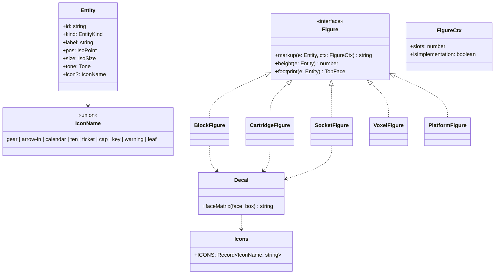
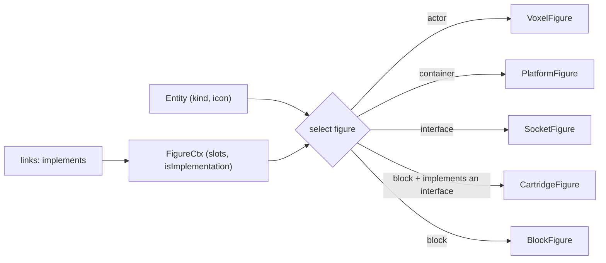

# Figures "Taller": richer isometric figures for the engine

Status: accepted and implemented (2026-11-19) · Spec: [docs/spec.md](../../spec.md) §8 (engine) · ADR: [0001-figuras-taller](../../adr/0001-figuras-taller.md) · Gallery: `/lab/figuras/` (the spike `web/src/lab/skins.ts` was removed once the engine took over)

## Intent

Users found the diagrams "too serious": every class is the same grey prism and only the colour and label change. We want figures that are friendlier and carry meaning, and we want them settled before the other 7 lessons reuse the engine. The user compared three options on `/lab/figuras/` (current, A "Taller", B "El box") and chose **A · Taller**.

## Goals

- Every entity reads at a glance:
  - **Blocks** (Spring beans) are machines. Each has an inset lid, an icon decal on the lid and a strip of LEDs on the right face.
  - **Interfaces** are a dashed **socket board** with one slot per implementation.
  - **Implementations** of an interface are **cartridges**: tall, narrow, with gold contacts and an icon on the front face.
  - **The actor** is a voxel figure with a face.
  - **Containers** are platforms with a floor grid and a Spring-leaf badge.
  - **`danger` blocks** carry tangled cables and a warning icon.
- Both themes keep working. Every colour stays a token.
- Highlight, hide and packets keep the same behaviour and the same CSS classes.
- Scenes stay plain data. A lesson picks icons by name and never writes SVG.

## Non-goals

- Option B (gym props) and per-pattern metaphors.
- Animation of the figures themselves (idle bobbing, LEDs blinking).
- Mobile zoom. That is a separate, known limitation.

## Anti-goals

- **Decoration that hides meaning.** Labels stay the primary identifier and keep their size and position rules.
- **Hand-drawn SVG inside lesson content.**
- **Breaking the static, no-JS render** or the a11y descriptions.

## Approaches considered

| | Approach | Trade-off | Decision |
|---|---|---|---|
| 1 | **New optional `icon` on `Entity`, with the figure derived from `kind` plus the links** | Smallest data change. An interface's slot count and an implementation's cartridge shape are derived from `implements` links, so lessons cannot get them out of sync. | **Chosen** |
| 2 | New `EntityKind`s (`cartridge`, `socket`, …) | Explicit, but it duplicates what the links already say and multiplies the kinds the validator and the renderer must handle. | Rejected |
| 3 | Pluggable "skins" (A/B switchable at runtime) | Flexible, but it is YAGNI. Only A was chosen, and every figure would need doubled tests. | Rejected |

## Design

- **`types.ts`.** Add `icon?: IconName` to `Entity` and export `IconName` as a string union.
- **New modules.** `engine/figures.ts` (figure functions) and `engine/icons.ts` (icon paths drawn in the unit square, plus `faceMatrix` for decals). The spike's code is the starting point. Its helpers get tests and get tidied.
- **`render.ts`.** `entityMarkup` delegates the shape to the selected figure. `labelAnchor`, `rimT` and the viewBox bounds use the figure's `height` and `footprint`, so arrows end at the real rim and labels clear the taller figures.
- **Validation (`validate.ts`).**
  - An unknown `icon` is a build error. TypeScript catches it in `scene.ts`; the validator catches it at runtime for safety.
  - An `icon` on an actor or a container is a build error.
- **Strategy lesson icons.**

  | Entity | Icon |
  |---|---|
  | controller | `arrow-in` |
  | service | `gear` |
  | legacy | `warning` |
  | monthly | `calendar` |
  | ten-pack | `ten` |
  | drop-in | `ticket` |
  | student | `cap` |
  | encoder | `key` |

  The demo fixture gets a couple of icons too, so the tests cover them.
- **Sizes.** Cartridges are about 0.7 × 0.45 × 0.8 of the tile, bigger than in the spike, which looked small. Blocks keep their footprint.
- **Lab page.** `/lab/figuras/` stays as a living gallery: every figure and every icon, in both themes, plus the Strategy scene step by step. It is rewired to the real engine, the spike's B column and `lab/skins.ts` are removed, and it keeps `noindex` and stays out of the sitemap.
- **Docs.** Add ADR `docs/adr/0001-figuras-taller.md` with the class diagram above, and update spec §8 (engine) and the content-model class diagram for `icon`.

## Testing

- **Unit (vitest).**
  - Each figure renders its expected structure: a block has a lid, an icon decal and LEDs; a cartridge has contacts; a socket has N slots; a voxel figure has a head.
  - Slot count equals the number of `implements` links into the interface.
  - `danger` blocks get cables.
  - Labels sit above the figure height.
  - The validator rejects unknown icons and icons on actors or containers.
  - Existing render tests are updated where markup changed.
- **E2E.** The existing lesson specs must stay green (step changes, highlight, no-JS). Add one check that the lab page renders in both themes without console errors.

## Left to the builder

- Exact path coordinates of icons, LED and cable details, and colour mixes, within the tokens.
- Any internal helper structure, provided the public `renderScene` signature is unchanged.
